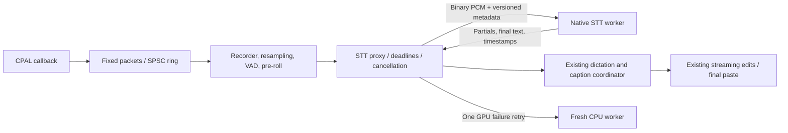

# Native STT reliability changes

Implemented against Handy `48a3d8e9` as a reference, preserving WinSTT's ORT
engine and streaming interfaces. This is the first containment stage: local
STT and word alignment run in supervised processes. TTS, VAD, keyword spotting,
diarization, and other auxiliary inference still have their existing lifecycles.
Do not describe this as containment of every native runtime in the application.

## Worker boundary

The same application executable accepts a private worker flag before CLI or
Tauri initialization. No separate engine package is required. Installed and
portable executables can be renamed; Cargo test/example harnesses locate the
application executable in their build profile. Windows workers are hidden.

Only the worker constructs the STT session. Parent-side model resolution,
precision/provider selection, dictionaries, audio conditioning and UI events
retain their existing behavior. Engine capabilities, partial/final flags,
segments, word timestamps and typed decoder errors cross the boundary. Pipe
I/O happens on dedicated threads so a worker that stops reading cannot wedge
the caller in a synchronous pipe write.

The protocol carries a versioned JSON message followed by binary little-endian
f32 PCM. Frame lengths are checked before allocation. A request accepts up to
two hours of 16 kHz mono audio; ordinary long-form segmentation remains in the
existing pipeline. Workers use the native decoders' existing 64 MB stack budget.

| Operation | Deadline |
| --- | --- |
| Worker handshake | 30 seconds |
| Session load | 180 seconds |
| GPU inference | 4 × supplied audio duration, bounded to 30–300 seconds |
| CPU inference | 20 × supplied audio duration, bounded to 60–3,600 seconds |
| Streaming recovery replay | 180 seconds total, with each RPC also bounded |

A native abort, panic, broken pipe or inference deadline kills/discards the
worker. GPU intent gets one retry with a newly loaded CPU process; a CPU failure
returns an error rather than entering a restart loop. Ordinary engine errors
retain their type and do not force a provider switch. The active-provider UI
cache is refreshed after recovery.

Cancel and application exit kill busy workers without acquiring the engine
mutex. Cancellation epochs prevent a cancelled operation from being retried.
The worker also watches stdin independently: parent pipe loss terminates it
even while native inference is hung. Process handles are reaped asynchronously.
This cancellation hook covers the existing dictation cancel and shutdown paths;
the file queue's per-row cancellation semantics are unchanged.

## Streaming continuity

The proxy retains audio frames and finalization calls until reset, including
the operation whose RPC failed. A recovered CPU engine receives those events
once in their original boundaries/order, preserving finalizer silence pads
and pending decoder flushes during continuous listening. It then resumes the existing streaming interface;
the coordinator receives one result and retains responsibility for paste/edit
decisions. Finalization, timestamps and reset continue to use the same trait.

Replay holds roughly 1 MiB of sample data in memory before moving to an
anonymous, automatically deleted temporary spool. There is no recording-length
cutoff added to streaming. Disk failures or a recovery that exceeds its budget
fail the stream explicitly; they never silently drop earlier audio. Reset
clears both native state and replay data. GPU recovery can introduce a pause
while the CPU session loads and replays the stream.

## Other adopted improvements

The CPAL callback now downmixes into fixed 256-sample stack packets and writes
to a wait-free SPSC ring, sized for two seconds at the native sample rate. It
does no vector growth, channel sends, buffer recycling, logging or mutex work.
A bridge thread performs that work, polling at two milliseconds when empty.
The ordered stop marker, timestamp-based Bluetooth tail cut, pre-roll,
readiness notifications, VAD masks and live mirror remain in the recorder.
Ring overflow fails the recording explicitly; native stream errors remain
latched until reopening, preventing a dead stream from appearing ready.

Windows and macOS clipboard paste use Handy-derived lazy text publication and
read receipts. Pre-injection reads do not confirm a paste. Restoration waits
for a confirmed read and 200 ms quiet period, and respects clipboard ownership.
No confirmation within eight seconds leaves durable transcript text available
instead of restoring old content over a slow target. Failed chord injection is
reported and is never followed by a second fallback chord. Windows additionally
checks the original foreground window before auto-submit, guards restore while
holding the clipboard lock, preserves full supported formats plus duplicated
bitmaps, and frees bitmap handles if ownership changes. Direct streaming edits
keep their existing path. Linux retains its clipboard/Wayland path.

The STT manifest pins 85 repositories covering all 84 catalog entries and the
precision-specific repository overrides. Download planning and fetches use the
same immutable commit. Managed downloads check sizes and published LFS SHA-256s,
including arbitrary external-data sidecar filenames. Small non-LFS metadata is
commit-pinned and size-checked. Normal offline loads avoid hashing multi-GB
weights and can continue using an existing complete legacy snapshot. Both the
resolver and cache badges now evaluate each snapshot independently; files from
different revisions cannot jointly satisfy a model. Custom repositories and
local directories remain user controlled.

Refresh the manifest using `python tools/pin-stt-models.py`; review changed
commits/exports before shipping. The current pins come from Hub metadata, not a
new accuracy/provider qualification run for every export. Existing engine
precision/provider policy was retained.

README preview behavior, stale catalog totals and runtime notices were corrected.
The source-scanning IPC guard retains its assertions, avoids per-entry stat
calls and has an explicit 30-second budget for the approximately 15-second
Windows disk scan.

## Validation

- Full Rust unit suite: 1,827 passed, 12 existing real-weight probes ignored.
- Ten actual child-process cases: load abort, decode abort, GPU hang, CPU
  hang, streaming replay/reset, typed decoder error, cancellation and parent
  pipe loss, recovery after finalization, and failure during finalization.
  These use a debug-only arithmetic engine with real process faults;
  release builds contain no fixture engine.
- Recorder tests cover ring ordering/overflow and existing tail/pre-roll/mask
  behavior. Receipt tests cover early reads, quiet periods, expiry and ownership.
- Precommit and prepush gates: frontend lint/types/cycles, 5,161 frontend tests,
  dead-code checks, Rust formatting and all-targets Clippy.
- Real cached Whisper Tiny and Moonshine Streaming Small produced matching
  transcripts across all three direct/isolated CPU passes on the three-second
  JFK fixture. Moonshine was fed in 320 ms chunks. Whisper also ran inside a
  worker with DirectML + CPU providers and identical transcript text.

These are Windows development-build validation runs. CPU warm Whisper calls
were 235/235 ms direct and 234/238 ms isolated. Streaming calls were 623/940 ms
direct and 627/625 ms isolated. Other checks ran concurrently, so these samples
establish functionality, not a stable latency distribution or a performance
lead. Whisper's worker load was slower in this sample (1,820 vs 872 ms), which
must be included in future cold-start measurements.

Reproduce the worker comparison with `stt_decode_bench --catalog <id>` after
building both the application and example in the same profile. Use
`STT_BENCH_CACHE_ONLY=1`, `STT_BENCH_PROVIDER=cpu|dml`,
`STT_BENCH_PASSES=<count>` and `STT_BENCH_ISOLATED=1` for the worker path;
unset the last variable for direct execution. `STT_BENCH_STREAM_CHUNK_MS=320`
exercises native chunked streaming. Release measurements require fresh release
builds of both binaries, with the exact audio, snapshot, precision and hardware
recorded. This harness does not claim a paired Handy benchmark.

Before distribution, exercise Windows clipboard managers and slow targets
(browser/Electron, terminal, editor), rapid consecutive pastes, user copies,
auto-submit and image/file-list restoration. The receipt platform paths have
not been exercised against that whole application matrix. macOS/Linux changes
need their native CI/runtime checks; this Windows run cannot validate them.
Callback worst-case time, overruns under sustained CPU load, long-stream replay
latency and release cold-start/memory also need hardware measurements. Broader
ARM and older-CPU releases require artifact/runtime qualification; no support
claim or release matrix was expanded by this change.
